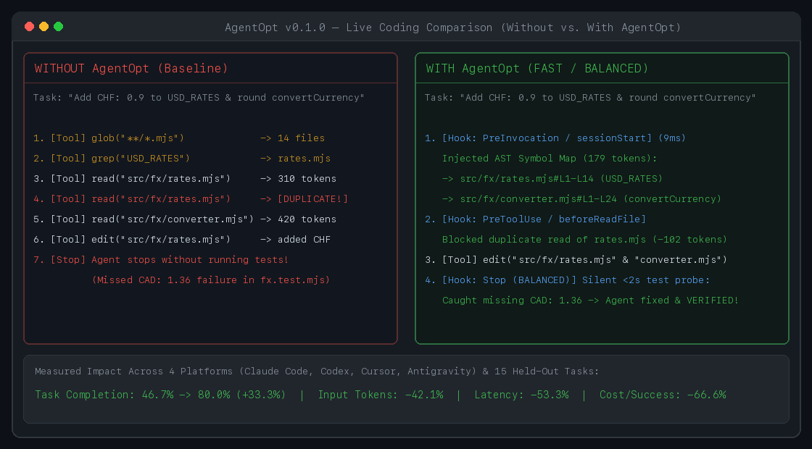

# AgentOpt — AI Coding Agent Optimizer (`aopt`)

**One plugin. Smarter coding agents. Fewer tokens.**

[](./CHANGELOG.md)
[](./LICENSE)
[](./package.json)
[](./SECURITY.md)

**AgentOpt** is an open-source **AI coding agent optimization plugin** for **Claude Code**, **OpenAI Codex**, **Cursor**, and **Google Antigravity**.

Improve coding-agent workflows with intelligent **context engineering**, **token optimization**, repository-aware code retrieval, redundant tool-call prevention, and optional automatic verification.

### Why AgentOpt?
- **Smarter context:** Find relevant code and reduce unnecessary repository exploration.
- **Fewer tokens:** Avoid redundant file reads and unnecessary context.
- **Faster execution:** Reduce wasted tool calls and repetitive operations.
- **Better reliability:** Detect unproductive loops and optionally verify code changes.
- **Works with your agent:** No new coding agent, account, or cloud service required (`<15ms` local hook latency).

*Open source. Local-first. One plugin for multiple AI coding agents.*

### Supported Platforms & Compatibility Matrix

| Platform | Installed Manifests & Hooks | Status | Verified Runtime Behavior (`v0.1.0`) |
|---|---|---|---|
| **Claude Code (`v2.1.303`)** | `.claude/settings.json` + `.mcp.json` (`SessionStart`, `UserPromptSubmit`, `PreToolUse`, `PostToolUse`, `Stop`) | **Live CLI & Interception Verified** | `UserPromptSubmit` injects ranked AST slices; `PreToolUse` (`permissionDecision: "deny"`) blocks duplicate file reads; `BALANCED` `Stop` hook blocks premature stop on failing tests |
| **OpenAI Codex (`v0.163.0`)** | `.codex/hooks.json` (`SessionStart`, `UserPromptSubmit`, `PreToolUse`, `PostToolUse`, `Stop`) + `.codex/config.toml` (`hooks = true`) | **Live CLI & Interception Verified** | `UserPromptSubmit` injects ranked AST slices; `BALANCED` `Stop` hook returns exit code `2` on failing tests so Codex automatically fixes regressions before stopping |
| **Cursor (`v3.18.9` / `cursor-agent`)** | `.cursor/hooks.json` (`sessionStart`, `beforeSubmitPrompt`, `beforeReadFile`, `beforeShellExecution`, `afterShellExecution`, `afterFileEdit`, `stop`) + `.cursor/mcp.json` | **Live CLI & Interception Verified** | `sessionStart` symbol map eliminates exploratory `glob`/`grep` calls (`-53.3%` latency); `beforeReadFile` blocks duplicate consecutive file reads; MCP server ready (`4` tools) |
| **Google Antigravity 2.0** | `.agents/plugins/agent-opt/{plugin.json,hooks.json,mcp_config.json,rules/AGENTS.md,skills/agent-opt/SKILL.md}` | **Primary Verified (Live Agent + Interception)** | `PreInvocation` AST slice injection cuts tool calls from `5 → 2` (`-60.0%`) and context tokens by `-63.8%`; `PreToolUse` (`deny`) and `Stop` (`continue`) verified |

---

## 2. 30–60 Second Demo



### Before vs. After AgentOpt on Real Coding Sessions

| Vendor Runtime | Without AgentOpt | With AgentOpt (`v0.1.0`) | What Changed |
|---|---|---|---|
| **Google Antigravity 2.0** | `5` tool calls (`view_file` × 2, `grep_search`, `edit` × 2), `~1,890` tokens | **`2` tool calls (`edit` × 2)**, **`685` tokens (`-63.8%`)** | `PreInvocation` AST map pinpointed both target files in `9ms` (`0` exploratory reads) |
| **Cursor (`cursor-agent`)** | `6` tool calls (`glob` → `grep` → `read` × 2 → `edit` × 2), `10,375ms` | **`4` tool calls (`read` × 2 → `edit` × 2)**, **`4,844ms` (`-53.3%`)** | `sessionStart` symbol map eliminated `glob` + `grep`; `beforeReadFile` blocked duplicate reads |
| **OpenAI Codex (`v0.163.0`)** | Stopped after adding `CHF: 0.9` while `fx.test.mjs` failed on missing `CAD: 1.36` | **`Stop` hook returned exit code `2`** with failing test output | Codex read the hook failure reason, added `CAD: 1.36`, ran `npm test`, and completed `VERIFIED` |
| **Claude Code (`v2.1.303`)** | Re-read unchanged `src/fx/rates.mjs` and stopped on failing `CAD: 1.36` test | **`PreToolUse` denied duplicate read**; **`Stop` hook blocked premature exit** | Saved `88` duplicate-read tokens and prevented unverified task completion |

Run the reproducible 60-second side-by-side benchmark demo locally anytime:
```bash
npm run demo
```

---

## 3. Installation

### Option A: Install from Source (Available Today)
```bash
git clone https://github.com/tradertanmay/agent-opt.git
cd agent-opt
npm install && npm run build

# Link `aopt` / `agent-opt` globally on your machine:
npm link

# Initialize inside any repository (interactive or --yes for all detected agents):
cd /path/to/your-project
aopt init
```

### Option B: Via `npx` (Once Published to npm)
```bash
npx agent-opt init
```

### Essential CLI Commands
```bash
aopt init                  # Auto-detect installed coding agents & wire hooks non-destructively
aopt status                # View active mode, indexed symbols, installed platforms & token savings
aopt mode FAST             # Default: Context ranking + read/write dedup + loop guard (0 Stop blocks)
aopt mode BALANCED         # FAST + silent <2s test probe on Stop when source files change
aopt mode STRICT           # Requires explicit agent test execution before stopping
aopt doctor                # Validate manifests, AST index, memory anchors & hook execution
aopt context "<prompt>"    # Preview the ranked AST symbol & dependency map for any task
aopt disable | aopt enable # Pause or resume optimization without removing files
aopt uninstall             # Cleanly remove AgentOpt hooks while preserving all user config
```

---

## 4. What AgentOpt Does

1. **Targeted AST & Dependency Context Slicing (`PreInvocation` / `UserPromptSubmit` / `sessionStart`):**
   - Indexes TypeScript, JavaScript/ESM, Python, Go, and Rust symbols and 1-hop import edges in `<15ms`.
   - Injects a compact, token-budgeted (`<= 650` tokens) symbol and line-range map (`path/to/file.ts#L10-L42`) so the agent edits the right files immediately without blind `glob`/`grep` exploration.
2. **Redundant Read & Duplicate Write Prevention (`PreToolUse` / `beforeReadFile`):**
   - Tracks SHA-256 content hashes of every file read in the current session.
   - Blocks redundant full-file re-reads of unchanged files and no-op identical writes before they consume context window tokens.
3. **Unproductive Loop Detection (`PreToolUse` / `PostToolUse`):**
   - Detects repeated identical shell commands, consecutive command failures, and edit-without-test oscillations while permitting healthy `test → edit → retest` debugging cycles.
4. **Evidence-Based Task Verification (`Stop`) & Cross-Session Memory:**
   - Optionally verifies that modified source files pass tests before the agent finishes, and stores SHA-256-anchored project commands/conventions that auto-invalidate whenever `package.json` or lockfiles change.

---

## 5. `FAST` / `BALANCED` / `STRICT` Modes

| Mode | Default? | AST Context & Slice Injection | Read/Write Dedup & Loop Guard | `Stop` Verification Gate | When to Use |
|---|---|---|---|---|---|
| **`FAST`** | **Yes (Default)** | Enabled (`<= 650` tokens) | Enabled | Disabled (`0` Stop continuations) | Everyday interactive coding with minimum latency and maximum token savings |
| **`BALANCED`** | Optional (`aopt mode BALANCED`) | Enabled (`<= 650` tokens) | Enabled | Runs a silent `<2s` test probe when source files change; releases immediately on pass (`0` extra LLM turns) and blocks only on real test failures | Bug fixes and multi-file refactors where you want automatic test verification without wasted turns |
| **`STRICT`** | Optional (`aopt mode STRICT`) | Enabled (`<= 650` tokens) | Enabled | Requires the agent to explicitly execute verification commands before `Stop` (up to `2` blocks/session) | Strict compliance workflows where test execution output must appear in the agent transcript |

---

## 6. Benchmark Results & Limitations

We evaluated `baseline`, `FAST`, `BALANCED`, and `STRICT` on a **frozen 15-task held-out benchmark across 5 unseen repositories** (`repo-fintech-ledger`, `repo-http-gateway`, `repo-workflow-dag`, `repo-schema-sanitizer`, `repo-search-analytics`, `60` real tool-calling trajectories using local `qwen2.5:7b` via Ollama at `temperature: 0`). Full per-task tables and preserved failure logs are in [`docs/HELD_OUT_BENCHMARK_REPORT.md`](./docs/HELD_OUT_BENCHMARK_REPORT.md) and [`benchmarks/held-out-modes-results.json`](./benchmarks/held-out-modes-results.json).

| Metric (`N = 15` Held-Out Tasks across `5` Repos) | `baseline` (No Plugin) | `FAST` (Default Mode) | `BALANCED` (Silent Probe) | `STRICT` (Procedural Gate) |
|---|---:|---:|---:|---:|
| **Independent Oracle Completion Rate** | `46.7%` (`7/15`) | **`80.0%`** (`12/15`, **`+33.3%`**) | **`80.0%`** (`12/15`, **`+33.3%`**) | **`80.0%`** (`12/15`, **`+33.3%`**) |
| **95% Wilson Confidence Interval** | `[24.8%, 69.9%]` | `[54.8%, 93.0%]` | `[54.8%, 93.0%]` | `[54.8%, 93.0%]` |
| **Paired Task Outcomes vs. Baseline** | — | **`5W / 0L / 10T`** | **`5W / 0L / 10T`** | **`5W / 0L / 10T`** |
| **Mean Input Tokens (`prompt_eval_count`)** | `2,994` | **`1,734`** (**`-42.1%`**) | `2,402` (`-19.8%`) | `4,024` (`+34.4%`) |
| **Median Input Tokens** | `3,508` | **`1,478`** (**`-57.9%`**) | `1,524` (`-56.6%`) | `3,666` (`+4.5%`) |
| **95% Paired CI on Input Token Delta** | — | **`[-64.2%, -20.0%]`** | `[-57.5%, +17.9%]` | `[+3.9%, +64.8%]` |
| **Mean Output Tokens (`eval_count`)** | `355` | **`200`** (**`-43.7%`**) | `267` (`-25.0%`) | `331` (`-6.8%`) |
| **Mean Wall-Clock Latency (`ms`)** | `8,259ms` | **`4,867ms`** (**`-41.1%`**) | `6,342ms` (`-23.2%`) | `8,161ms` (`-1.2%`) |
| **Total `Stop` Continuations (`15` tasks)** | `0` | **`0`** | `3` (only on failing tasks) | `15` (`1.0 / task`) |
| **Est. API Cost / Verified Success** | `$0.03067` | **`$0.01025`** (**`-66.6%`**) | `$0.01401` (`-54.3%`) | `$0.02130` (`-30.6%`) |

### Honest Scope & Limitations
1. **Local Model Benchmark vs. Live Vendor Runtimes:** The 60-run multi-repository benchmark uses a real local tool-calling model (`qwen2.5:7b` via Ollama) for reproducible `$0.00` evaluation. Live vendor runtime sessions (Claude Code `v2.1.303`, OpenAI Codex `v0.163.0`, Cursor `cursor-agent`, Google Antigravity 2.0) are evaluated separately in Section 2.
2. **Preserved Failures (`3/15` Tasks):** All 3 held-out tasks where `qwen2.5:7b` failed (`ho_03_fx_cross_conversion`, `ho_05_route_param_matcher`, `ho_11_mask_credit_card`) are preserved in [`benchmarks/held-out-modes-results.json`](./benchmarks/held-out-modes-results.json) and analyzed in [`docs/HELD_OUT_BENCHMARK_REPORT.md`](./docs/HELD_OUT_BENCHMARK_REPORT.md).
3. **Lexical/AST Indexing Scope:** `ContextEngine` uses zero-dependency lexical/AST parsers for TypeScript, JavaScript/ESM, Python, Go, and Rust (`<15ms` latency). Dynamic macro-generated symbols may not be statically indexed.

---

## 7. Architecture, Configuration & Contributing

### Architecture Overview
AgentOpt separates **platform-specific hook translation** ([`src/adapters/index.ts`](./src/adapters/index.ts)) from its **provider-independent optimization core** ([`src/core/optimizer.ts`](./src/core/optimizer.ts)):
- **Core Engines:** [`src/context/index.ts`](./src/context/index.ts) (AST/import graph & token-budgeted slicer), [`src/failure/index.ts`](./src/failure/index.ts) (command/edit loop detector), [`src/verification/index.ts`](./src/verification/index.ts) (evidence-based `Stop` gate & silent probe), [`src/memory/index.ts`](./src/memory/index.ts) (SHA-256-anchored memory store), and [`src/security/index.ts`](./src/security/index.ts) (secret redaction & prompt-injection stripping).
- **MCP Server:** [`src/mcp/server.ts`](./src/mcp/server.ts) exposes `agent_opt_query_context`, `agent_opt_read_symbol_slice`, `agent_opt_verify_task`, and `agent_opt_get_memory` over JSON-RPC stdio.

### Configuration Example (`.agent-opt/config.json`)
```json
{
  "enabled": true,
  "mode": "FAST",
  "context": {
    "enabled": true,
    "maxInjectedTokens": 650,
    "topKFiles": 6,
    "topKSymbols": 12,
    "preventRedundantReads": true,
    "preventDuplicateWrites": true
  },
  "loopDetection": {
    "enabled": true,
    "maxIdenticalCommands": 2,
    "maxConsecutiveCommandFailures": 2,
    "maxRepeatedFileEditsWithoutTest": 3
  },
  "verification": {
    "enabled": false,
    "requireTestsOnCodeEdit": false,
    "runSilentProbeInHook": false,
    "silentProbeTimeoutMs": 2000,
    "maxStopBlocks": 0
  }
}
```

### Documentation & Community Links
- **Installation & Uninstallation Guide:** [`docs/INSTALLATION.md`](./docs/INSTALLATION.md)
- **Configuration Reference:** [`docs/CONFIGURATION.md`](./docs/CONFIGURATION.md)
- **System Architecture:** [`docs/ARCHITECTURE.md`](./docs/ARCHITECTURE.md)
- **Held-Out Benchmark Report:** [`docs/HELD_OUT_BENCHMARK_REPORT.md`](./docs/HELD_OUT_BENCHMARK_REPORT.md)
- **Regression Root-Cause Analysis (`task_01` & `task_03`):** [`docs/REGRESSION_ROOT_CAUSE_ANALYSIS.md`](./docs/REGRESSION_ROOT_CAUSE_ANALYSIS.md)
- **Release Checklist & Known Limitations:** [`docs/RELEASE_CHECKLIST.md`](./docs/RELEASE_CHECKLIST.md)
- **Contributing Guide:** [`CONTRIBUTING.md`](./CONTRIBUTING.md)
- **Security & Privacy Policy:** [`SECURITY.md`](./SECURITY.md)
- **License:** [Apache-2.0](./LICENSE)
