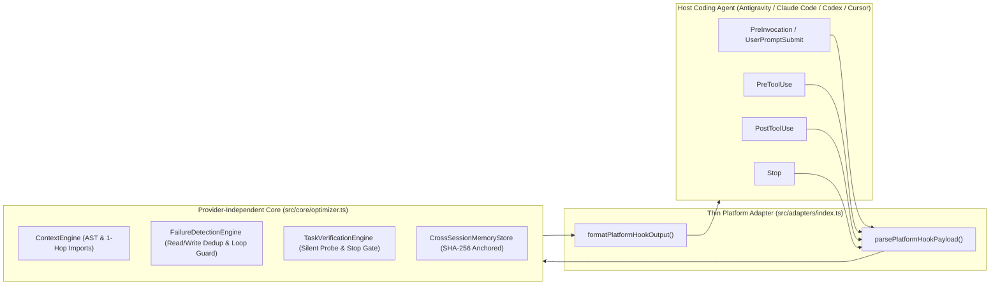

# AgentOpt — System Architecture

**AgentOpt** is a local-first, zero-dependency optimization layer that wraps existing AI coding agents via a **provider-independent core** (`AgentOptimizerCore`) and thin **platform adapters** (`Google Antigravity 2.0`, `Claude Code`, `OpenAI Codex CLI`, `Cursor`).

---

## 1. Provider-Independent Core ([`src/core/optimizer.ts`](../src/core/optimizer.ts))

All platform hooks normalize into a single [`NormalizedHookEvent`](../src/types/index.ts) structure and return a provider-independent [`OptimizationDecision`](../src/types/index.ts) (`action: 'allow' | 'block' | 'modify'`, `injectedContext`, `agentFeedback`, `diagnostics`).

### 1.1 Intelligent Context Optimization ([`src/context/index.ts`](../src/context/index.ts))
- **AST Symbol & Import Graph:** Indexes functions, classes, ES6 class methods (`get`, `set`, `enqueue`, `dequeue`), interfaces, types, constants, and relative imports across TypeScript, JavaScript/ESM, Python, Go, and Rust.
- **1-Hop Dependency Propagation & Distractor Filtering:** Ranks candidate files by lexical, path, and symbol overlap, propagates relevance across 1-hop imports/importers, penalizes generic utility paths (`src/core/env.*`, `src/utils/time.*`), and prunes `score === 0` distractors.
- **Targeted Inline Slices (`<= 650` tokens):** Injects compact symbol line ranges and complete current file slices for small target files (`<= 45` lines) with a recursion/variable safety guard.
- **Redundant Read & Duplicate Write Prevention:** Tracks per-session file SHA-256 hashes to block back-to-back redundant full-file reads of unchanged files and duplicate identical `write_file` calls while always permitting targeted line-slice reads and re-reads after intervening operations.

### 1.2 Failure & Loop Detection ([`src/failure/index.ts`](../src/failure/index.ts))
- **Unproductive Command Loop Guard:** Blocks re-running the exact same failing shell command (`PreToolUse`) when no source file has been modified since the prior failures, while always permitting healthy `test (fail) -> edit source -> test` cycles.
- **Edit Oscillation Detection:** Tracks per-file SHA-256 history (`H1 -> H2 -> H1`) to detect revert loops and alert the agent.
- **Stack-Trace Failure Pinpointing:** Extracts `file:line` coordinates from failing test/build stderr and injects a 15-line source snippet around the failure site (`PostToolUse`).

### 1.3 Modular Task Verification ([`src/verification/index.ts`](../src/verification/index.ts))
- **`FAST` Mode (Default):** Zero `Stop` continuations; lowest latency and token usage.
- **`BALANCED` Mode (Optional):** When source files are modified without a subsequent test run, executes a silent `<2s` verification probe (`runSilentVerificationProbe` with `NODE_TEST_CONTEXT` stripped) inside the `Stop` hook. If tests pass (`exitCode === 0`), the session is marked `VERIFIED` and `Stop` is allowed immediately (`0` extra LLM turns). Only blocks `Stop` when tests or explicit prompt requirements actually fail.
- **`STRICT` Mode (Optional):** Requires explicit agent test execution after source edits (up to `2` `Stop` continuations per session).

### 1.4 Cross-Session Verified Memory ([`src/memory/index.ts`](../src/memory/index.ts))
- Stores empirically verified project facts (test commands, build scripts, module conventions) anchored to the workspace `package.json`/`pyproject.toml` SHA-256 hash.
- Automatically invalidates stale entries whenever the project manifest changes or a command fails with `missing script`/`command not found`.

### 1.5 Security, Privacy & Fail-Open Guarantee ([`src/security/index.ts`](../src/security/index.ts))
- **100% Local Execution:** Zero external network calls, zero telemetry uploads, zero API keys required.
- **Secret Exclusion & Redaction:** Automatically excludes `.env*`, `*.pem`, `*.key`, `id_rsa`, and credentials from indexing, and scrubs inline bearer tokens/keys and prompt-injection patterns from all injected context.
- **Fail-Open Hook Execution:** Any malformed stdin payload or unexpected error exits `0` with `{}` so AgentOpt never interrupts the host agent.
